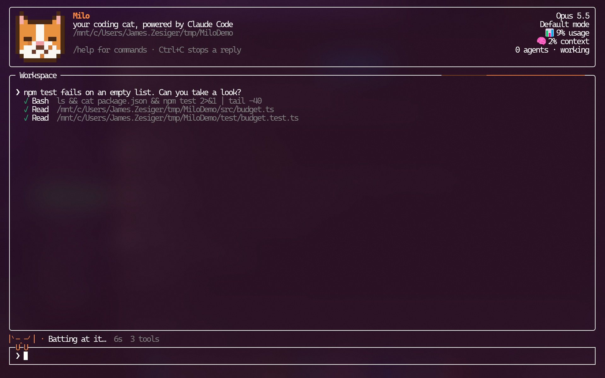
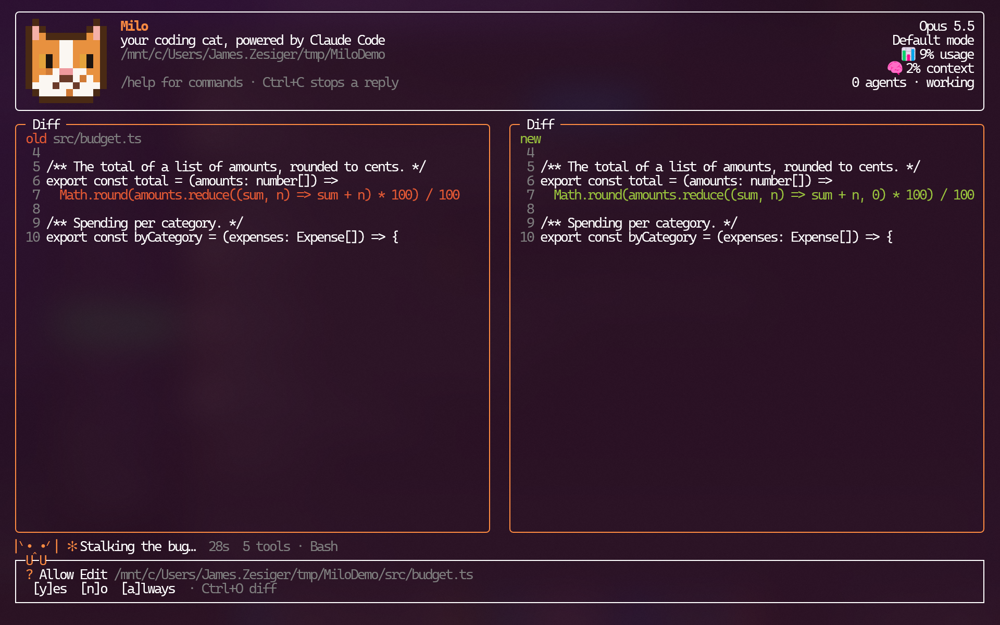
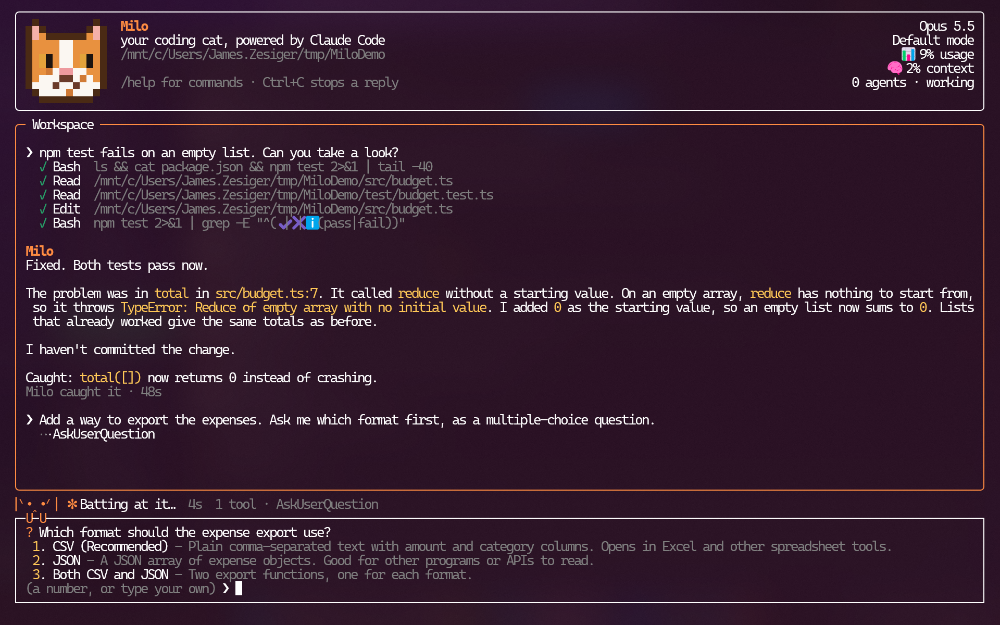
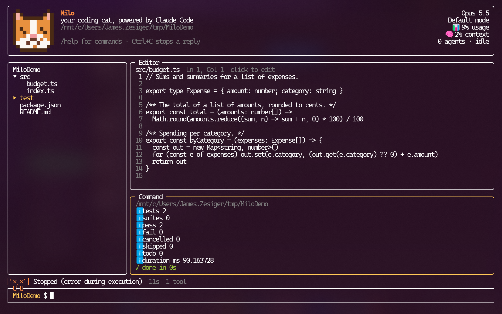
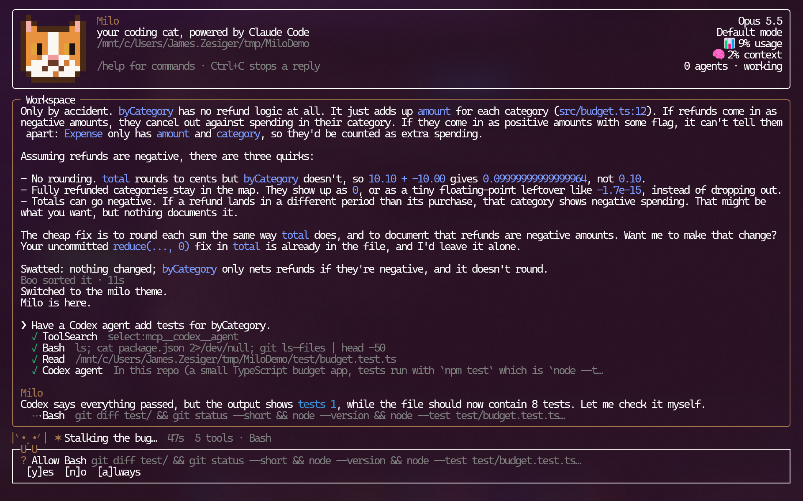
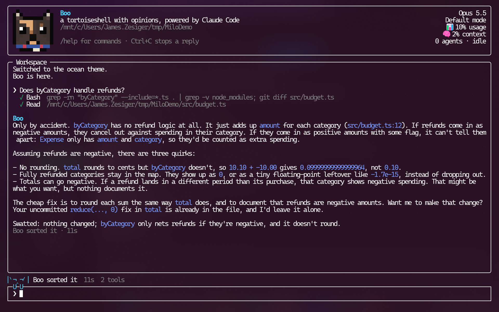

# Milo

Milo is a cat-themed terminal front end for Claude Code. Claude Code runs in the
background through the Claude Agent SDK, and Milo gives it a full-screen home:
a chat workspace, a file explorer, a code editor and a command line, with a cat
who reacts as Claude thinks and works.



## A quick tour

**Approve changes side by side.** When Claude wants to edit a file, Milo shows
the old and new versions next to each other and waits for a yes, no or always.



**Answer Claude's questions.** When Claude needs a decision, the input box
turns into a short menu: pick a number or type your own answer.



**Browse, edit and run.** Ctrl+B opens a file explorer, an editor and a command
line beside the conversation.



**Hand work to Codex.** Claude can brief a Codex agent on your ChatGPT plan,
then check what it did before reporting back.



**Pick a mascot and a theme.** Boo brings a drier personality, and six color
themes suit dark and light terminals.



## Requirements

- Node.js 20 or later
- Claude Code signed in on this machine (or `ANTHROPIC_API_KEY` set). Milo uses
  the same account, settings, skills and subagents as Claude Code.
- Optional, for OpenAI models: Codex signed in with `codex login` (a ChatGPT
  plan works; no API key needed).

## Getting started

```sh
npm install
npm start          # build, then run Milo
```

To run `milo` from any folder:

```sh
npm run build
npm link
milo
```

Milo works in the folder you start it from. In a terminal it runs full screen;
when piped, or with `--plain`, it runs line by line.

| Script              | What it does                                    |
| ------------------- | ----------------------------------------------- |
| `npm start`         | Build and run                                   |
| `npm run dev`       | Run from source with `tsx`, no build step       |
| `npm run build`     | Typecheck and bundle to `dist/milo.js`          |
| `npm run typecheck` | Typecheck only                                  |
| `npm run frame`     | Print one frame of the app with sample content; pass `-- [columns] [rows] [character]` to set the size and mascot |

## Talking to Milo

Type a prompt and press Enter. Messages sent while Claude is busy wait their
turn. Image files named in a prompt, typed or dragged in, are sent as pictures,
and Ctrl+V or Alt+V pastes an image from the clipboard. Type `@` and a path to
send a file's contents with the prompt: Tab finishes the path from the
session's folder, and Tab again lists the choices. Files over 256 KB go by name
only, for Claude to read as it needs. (Codex gets the path and reads the file
itself.)

As in Claude Code, a paste over 100 characters, an image or a link shows in the
input as a short label, like `[Pasted text #1 +12 lines]`, `[Image #2]` or
`[Link #3]`, and goes to Claude in full. Backspace removes a label all at once.
Your prompts stand out in the workspace on their own background; a long one
folds to two lines, and a click shows it in full or folds it again.

While Claude works, an orange streak circles the workspace border. When Claude
is waiting on you to approve something or answer a question, the whole border
lights up.

When Claude wants to run a tool or edit a file, Milo asks first and shows the
change side by side. Shift+Tab cycles the permission mode: Default, Accept
edits, Plan and Auto.

### Commands

| Command          | What it does                                                   |
| ---------------- | -------------------------------------------------------------- |
| `/help`          | Show commands and keys                                         |
| `/commands`      | List every Claude Code command and skill you can use           |
| `/resume [n]`    | List recent conversations in this folder, or pick one up       |
| `/continue`      | Pick up the most recent conversation in this folder            |
| `/status`        | Show the folder, session, model, mode and account              |
| `/mode [name]`   | Show or switch the permission mode                             |
| `/agents`        | List the subagents Claude can use                              |
| `/model [name]`  | Switch model: an OpenAI one, or `codex`, moves to Codex; a Claude one moves back |
| `/milo [size]`   | Show the mascot: `small` or `big`, or `thinking`, `working`, `error` |
| `/char [name]`   | List the mascots, or switch to one: `milo`, `boo` or `none`    |
| `/diff`          | Show or hide the last file change                              |
| `/copy [n]`      | Copy the last reply, or the nth from last, to the clipboard    |
| `/settings`      | Show Milo's settings, or save one                              |
| `/theme [name]`  | List the color themes, or switch to one                        |
| `/new`           | Start a fresh conversation                                     |
| `/exit`          | Leave                                                          |

Anything else, including Claude Code commands like `/context`, `/compact` and
`/usage`, goes straight to Claude.

### OpenAI models through Codex

`/model gpt-5.6-sol` (or any model Codex lists, or `/model codex` for Codex's
default) hands the conversation to Codex, signed in with your ChatGPT plan.
`/model opus` goes back to Claude. Claude Code and Codex can't read each
other's conversations, so a switch starts a new one there and sends along what's
on screen (your prompts, the replies and the tool calls, up to about 8,000
characters, newest kept) with your next message. Switching between two models
on the same side keeps the conversation as it is.
The header's usage and context come from Codex's own log of the thread.

Codex can't ask before each action, so the permission mode picks its sandbox:
Plan reads only, Default and Accept edits can change files in the folder, and
Auto has full access. Claude Code's own commands, subagents and questions
aren't there with Codex, and Ctrl+O shows a file's change since the last
commit. Plain mode always uses Claude.

### Codex agents for Claude

While you talk to Claude, Milo gives it a `Codex agent` tool, so you can say
"have a Codex agent on gpt-6-astra fix the failing test". Claude writes the
agent a brief, Milo asks you before it starts (like any tool), and the agent
works in the folder on your ChatGPT plan. Claude gets back the agent's report,
the commands it ran and the files it changed, plus a thread id it can pass back
to send the same agent round again for fixes or follow-ups. The header counts
it as an agent while it runs, and the status line shows its current command.
It's read-only in Plan mode, or whenever Claude asks for a review only.

The tool is always loaded, so skills can use it too. A skill that wants both
providers names both tools in its steps, for example: start an `Agent` with
`model: "opus"` and an `mcp__codex__agent` call with
`model: "gpt-6-astra", read_only: true` in the same turn, giving both the same
brief, and then have Claude check both reports against the code before it
answers. Outside Milo the Codex tool doesn't exist, so a skill like this should
say what to do without it.

### Keys

| Key            | What it does                                                    |
| -------------- | --------------------------------------------------------------- |
| Tab            | Finish the command or `@file` you're typing                     |
| Ctrl+Backspace | Delete the word before the cursor, in the input and the editor (Alt+Backspace and, in the input, Ctrl+W too) |
| Ctrl+R         | Search earlier prompts as you type; Ctrl+R again goes further back, Enter keeps the match, Esc cancels |
| PgUp / PgDn    | Scroll the workspace or the diff (the mouse wheel works too)    |
| Ctrl+O         | Show or hide the last file change                               |
| Ctrl+B         | Show or hide the file explorer                                  |
| Ctrl+T         | Show or hide the sessions list                                  |
| Drag           | Select text in the workspace; letting go copies it              |
| Click          | Show a long prompt of yours in full, or fold it again. On a tool line, show the change it made, or open its file in the editor |
| ↑ ↓            | Move between the input's lines, then through earlier prompts    |
| Esc            | Stop a reply, or close the diff                                 |
| Ctrl+C         | Stop a reply (twice forces it), clear the input, or leave (twice) |

## Sessions

Ctrl+T opens a list beside the conversation. It shows every session open in
this Milo, followed by saved Claude Code conversations from every folder,
newest first. Several sessions can work at once, each in its own folder.
A working session's mark spins, ◆ means it's waiting on you, and the header
counts the sessions you aren't looking at.

- **↑ ↓ and Enter** (or a click): show an open session, or open a saved one
  next to the others in its own folder.
- **n**: start a new conversation in this folder.
- **x**: close the picked session. Press it twice if the session is still
  working.
- **r**: rename the picked conversation. The input box shows its name to
  edit; Enter saves it, Esc cancels, and an empty name goes back to the first
  prompt. Claude Code conversations keep the name in Claude Code too.
- **p**: pin the picked conversation to the top of the list, or unpin it.
  Pinned ones stay listed however old they get.
- **/**: filter the list. Type words to match against names, folders and
  prompts, in any case; ↑ ↓ still move, Enter shows the picked one and keeps
  the filter, and Esc clears it. Filtering looks back through the last 200
  saved conversations, not just the 30 the list usually shows.
- **Del**: delete the picked conversation for good. Press Del once to ask,
  and again to delete. An open session is closed first; if it's the only one,
  a fresh conversation takes its place.
- The list keeps the keyboard after you switch, so you can move between
  sessions, until you close it with Ctrl+T.
- **Esc**: go back to the prompt. The list stays open while you talk, and
  Ctrl+T (or a click) takes the keyboard back to it.

Pins and names are kept in `~/.milo/sessions.json`.

Milo, the explorer and the command line move into the folder of whichever
session is on screen. When a session you aren't looking at finishes, or needs
an answer, the status line tells you.

## File explorer, editor and command line

Ctrl+B opens the explorer beside the workspace, and the input box becomes a
command line, ready to type in.

- **Explorer:** arrow keys or letters to move, → and ← to open and close
  folders, Enter or a click to open a file.
- **Editor:** Ctrl+S saves, Ctrl+W closes, Ctrl+Z and Ctrl+Y undo and redo.
  An open file reloads when Claude changes it, unless it has unsaved changes.
- **Command line:** commands run in your shell, with output in the terminal
  pane. Tab completes commands and paths, ↑ and ↓ go through earlier commands,
  and Ctrl+C stops a running command. If the shell you start Milo from runs
  oh-my-posh, the terminal pane shows your oh-my-posh prompt before each
  command; the input line keeps the folder name and `$`.

A plain `cd` moves the explorer and Claude Code to the new folder, keeping the
same conversation. If Claude is mid-reply, the move happens when the reply ends.

Alt+1, Alt+2 and Alt+3 jump straight to the explorer, the editor and the
command line, and a click works too. Esc steps back from the editor to the
explorer to the command line. Ctrl+B closes them and goes back to talking to
Milo.

## Settings

Milo's own settings live in `~/.milo/settings.toml`, one `key = "value"` per
line. Claude Code's settings stay in `~/.claude`.

| Setting        | Meaning                                                      |
| -------------- | ------------------------------------------------------------ |
| `default_mode` | The permission mode Milo starts in: Default, Accept edits, Plan or Auto |
| `theme`        | Milo's colors: milo, tabby, ocean, forest, violet or light   |
| `character`    | The mascot and its personality: milo, boo or none            |

Set one from inside Milo with `/settings default_mode Auto`.

### Themes

`/theme` lists the color themes with a sample of each, and `/theme ocean`
switches to one at once and saves it for next time. The `milo` theme uses your
terminal's own colors; the others use fixed shades, and `light` suits
light-background terminals. Themes live in `src/theme.ts`, each giving a shade
to the four colors Milo uses: accent, focus, ok and error.

### Characters

The mascot in the header, and the personality Claude speaks with, is a
character. `/char` lists them and `/char boo` switches at once and saves it for
next time.

| Character | Who                                                              |
| --------- | ---------------------------------------------------------------- |
| `milo`    | The default: an orange and white cat, warm and brief             |
| `boo`     | A tortoiseshell with tortitude: dry, confident, a little sassy   |
| `none`    | No mascot and no added personality: Claude's own voice           |

A new personality means restarting Claude Code, which Milo does on the same
conversation, waiting for any reply in progress to finish. Characters live in
`src/characters.ts`, and each cat's coat in `src/portrait.ts`.

## Project layout

```
src/
  index.ts      entry point: full screen or plain mode
  tui.tsx       the full-screen app (Ink)
  plain.ts      line-by-line mode
  session.ts    the background Claude Code session
  commands.ts   Milo's slash commands
  explorer.ts   the file tree
  editor.ts     the code editor
  terminal.ts   the command line: running commands, cd and completion
  images.ts     images in prompts and from the clipboard
  settings.ts   ~/.milo/settings.toml
  theme.ts      the color themes
  milo.ts       colors and moods
  characters.ts the mascots: names, faces, words and personalities
  portrait.ts   the mascot's portrait
build/
  bundle.mjs    bundles the app into dist/milo.js with esbuild
```

## License

Apache License 2.0. See [LICENSE](LICENSE).
